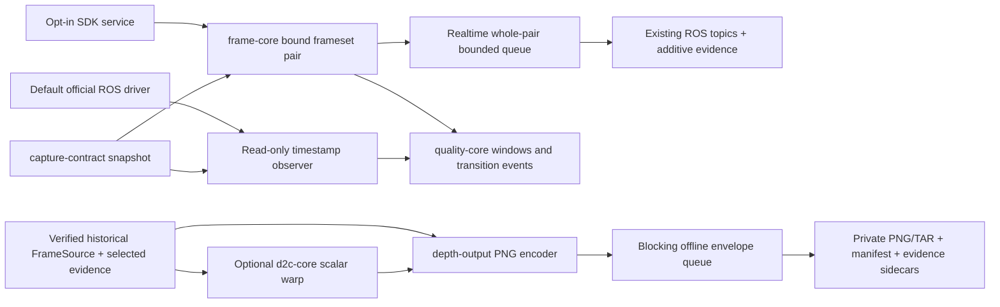

# RGB-D reusable data chain: ten reviewable changes

This series implements the first reusable Rust data-chain version. Camera lifecycle remains in GeminiDepthPort; the official ROS driver stays the default and the Rust acquisition service remains opt-in. application recording tasks, robot fields and episode validity are outside the libraries. Existing raw ROS Image/CameraInfo topics and MCAP interpretations are not changed.

## Review and integration order

Each PR is a small conceptual step on the previous branch, allowing reviewers to inspect its own diff and merge the stack in order. PRs #19–#24 have entered main. PRs #25–#27 were merged into their predecessor feature branches, so their implementations are reviewed there but are not all in main yet. PR #28 is the integration entry for D2C, lossless output and the offline CLI into main. No agent auto-merges this series.

1. [#19 — capture-contract identities](https://github.com/soulteary/GeminiDepthPort/pull/19): validated IDs, monotonic domains, depth representation, canonical content hashes and metre/row-major geometry.
2. [#20 — immutable snapshots](https://github.com/soulteary/GeminiDepthPort/pull/20): configuration/calibration/runtime bindings, private immutable store and read-only legacy import.
3. [#21 — durable recording protection](https://github.com/soulteary/GeminiDepthPort/pull/21): preparing/ACK/recheck/active, persistent recording gates, explicit credentialed release and supervisor instance identity. Its Rust 1.85 CI incompatibility was fixed in the same PR; the corrected checks passed.
4. [#22 — bound SDK pair evidence](https://github.com/soulteary/GeminiDepthPort/pull/22): one frameset, independent source clocks and indices, immutable actual-SDK snapshot, whole-pair ownership and additive ROS evidence topic.
5. [#23 — quality-core and SDK adapter](https://github.com/soulteary/GeminiDepthPort/pull/23): bounded windows/events, monotonic stale detection, explicit source-age map, transition-only events and private machine-readable quality files.
6. [#24 — official ROS observer](https://github.com/soulteary/GeminiDepthPort/pull/24): read-only rclpy decoder plus persistent Rust association/query engine, explicit watermark and ambiguous-component rejection; provenance is observed_timestamp.
7. [#25 — D2C models/rays](https://github.com/soulteary/GeminiDepthPort/pull/25): strict pinhole/Brown/rational models, bounded inverse solve and calibration-keyed bounded cache.
8. [#26 — scalar D2C warp](https://github.com/soulteary/GeminiDepthPort/pull/26): deterministic nearest-pixel projection, prequantization color-Z occlusion, explicit millimetre quantization and invalid output on whole-frame failure.
9. [#27 — depth-output](https://github.com/soulteary/GeminiDepthPort/pull/27): single PNG encoding reused for directory/TAR, blocking offline backpressure, private provenance sidecars and no-replace atomic job publication.
10. [#28 — offline-depth entry](https://github.com/soulteary/GeminiDepthPort/pull/28): typed public directory FrameSource, snapshot/evidence/payload validation, optional explicit normalization or D2C, PNG/TAR export and actual CLI regression tests. The entry point has no application/MCAP-specific adapter.

## Data and responsibility boundaries

`SDK counts + original scale` and `u16 millimetres` are different representations. Normalized millimetres are lossless only relative to their own integer values; they do not recover fractional SDK counts. The original-depth export marker describes unchanged camera geometry, while D2C output explicitly describes color-camera Z. The source snapshot and exact source evidence remain attached to the derived output.

SDK pair evidence asserts that the caller extracted both handles from the same frameset; it does not certify hardware exposure synchronization. Official observed associations never become SDK frameset evidence. Publication success only means that publisher calls succeeded; partial publication cannot be rolled back and no consumer receipt is certified.

Physical accuracy is explicitly unverified. Only structural geometry is validated. The core transform is `p_color_m = R_depth_to_color * p_depth_m + t_depth_to_color_m`; caller-specific quaternion/mm conventions belong in adapters.

## Acceptance covered by automated tests

- Identities, strict JSON, domain-separated hashes, snapshot tampering/binding, private atomic stores and legacy digest compatibility.
- Independent stream progress, skew/missing/repeated/regressed candidates, whole-pair queue ownership, source-unit preservation and partial-publication boundary failures.
- Durable preparing/active gates, incorrect credentials, unavailable services and protection blocking automatic device recovery. Linux mock-native supervision has a dedicated CI test; macOS conditional zero-test runs are not counted as Linux evidence.
- Tick-driven stale, source-age mapping, bounded windows/cursor gaps, session transitions, unknown coverage, recovery hysteresis and 10,000 sustained faults without event-ring flooding.
- ROS observer exact/ambiguous/late/overflow candidates, independent Info arrival, explicit offset mapping, unknown SDK values, persistent CLI protocol and strict Python configuration decoding without pixel access.
- Nonidentity geometry, translation, different color-Z, occlusion, resolution differences, distortion/nonconvergence, endian/stride/truncation, invalid values and all-or-nothing D2C output.
- Pixel-exact decoded PNG, identical directory/TAR encoded bytes, archive completeness, source symlinks/hash/length failures, output sidecars remaining usable after source deletion, bounded blocking queues and explicit uncertain-commit errors.

CI explicitly includes every new Rust library/CLI at the declared Rust 1.85 minimum, plus the Python decoder tests. The final integrated workspace is checked locally with `cargo +1.85.0 test --locked --workspace`, all-target strict Clippy and formatting. Native ROS C++ bridge/runtime image builds are separate CI jobs.

## Remaining acceptance and future adapters

Implementation and synthetic verification do not substitute for physical acceptance. A later hardware run should feed both camera models through the new evidence/quality paths, observe real subscribers and induced interruptions under protection, and preserve raw source/snapshot/event artifacts. D2C needs a recorded official SDK difference report with matched calibration and explained algorithm differences; physical calibration accuracy remains a separate measurement.

The observer implements strict association, but initial delayed Info remains Unknown in historical quality samples. It does not retroactively rewrite that history, so FailClosed coverage is deliberately conservative; ReportOnly is the supported monitoring mode. The resident SDK quality adapter also explicitly supports ReportOnly and does not decide business episode validity.

The initial offline CLI accepts the documented bound-pair directory schema. Official observed-association recordings need a dedicated historical input adapter; they must not be relabelled as SDK framesets. MCAP decoding, application episode/robot fields and policy decisions remain adapters outside the general kernels. No performance comparison or new 30-minute stability result is claimed by this series.
